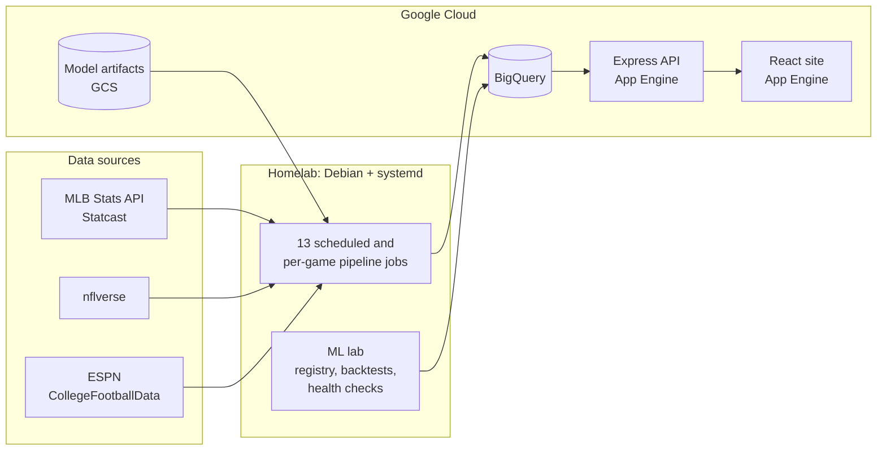

# Henry Craig

Software engineer in Atlanta. I build ML systems end to end: the data pipelines, the evaluation that
decides whether a model ships, and the infrastructure that keeps it running. MSCS student at Georgia
Tech, specializing in machine learning.

## Hank's Tank · [hankstank.com](https://hankstank.com)

A live prediction site for MLB, NFL and college football that I build and run myself. Every game
prediction, power ranking and season simulation on the site comes out of this pipeline:

What I'd point an engineer at:

- **Evaluation decides what ships.** A candidate model is backtested walk-forward against the current
  one on the same games, with paired-bootstrap confidence intervals, then runs as a live shadow before
  it can replace anything. In football a margin ridge model replaced XGBoost this way (NFL 2017–24
  log loss 0.634 vs 0.646; college 2025: 0.480 vs 0.531). The NFL comparison reruns on a laptop in
  seconds with [`make demo`](https://github.com/elijahcraig45/hanks_tank_ml/tree/main/demo), no account
  needed. Most candidates don't make it: a plate-appearance simulator, an NFL drive simulator and an
  Optuna search across seven model families all stayed out of production.
- **Honest numbers.** The MLB model picked 54.0% of 1,984 games correctly before first pitch in 2026,
  against a 52.8% home-team win rate. Baseball games are close to coin flips, and the
  [experiment log](https://github.com/elijahcraig45/hanks_tank_ml/blob/main/docs/EXPERIMENT_LOG.md)
  records how every claimed improvement held up.
- **Pipeline operations.** 13 production jobs (the daily MLB run, per-game predictions refreshed up to
  five times before first pitch, weekly football runs) moved from Cloud Functions to my homelab in
  three staged cutovers. Each job went off → dry run → live, with only one system writing at a time.
  The Cloud Functions stay deployed as a cold fallback.
- **Control without deploys.** A BigQuery control table lets me pause, pin or hide any model on the
  live site. The API, the site and the pipeline all read it, and all keep working if it's unavailable.
- **Monitoring that came from real failures.** Checks for stale data, missing or bad predictions, and
  model files that don't match their recorded hash push alerts to my phone. They exist because jobs
  failed while reporting success, including a stats refresh that left the NFL player page empty for
  two weeks.

| Repo | What's in it |
|---|---|
| [hanks_tank_ml](https://github.com/elijahcraig45/hanks_tank_ml) | Models, features, backtests, shadow models, rankings, season sims (Python) |
| [hanks_tank_backend](https://github.com/elijahcraig45/hanks_tank_backend) | The API (TypeScript, Express) |
| [hanks_tank](https://github.com/elijahcraig45/hanks_tank) | The site (React, D3) |
| [hanks_tank_lab](https://github.com/elijahcraig45/hanks_tank_lab) | The ML lab and control plane: registry, backtests, pipeline runner, health checks (Python) |

## Homelab

A small Dell OptiPlex running Debian: around 20 containers (photos with on-device ML, media, documents,
DNS), the ML lab and the production pipeline jobs. Nothing is exposed to the public internet; remote
access goes over Tailscale. The host is described in Ansible (15 roles), monitored with Uptime Kuma
and custom host checks, and backed up nightly with an offsite copy in Google Cloud Storage. A
Raspberry Pi runs a touchscreen [wall calendar](https://github.com/elijahcraig45/wallCalendar). The Ansible,
monitoring and backup code and the incident write-ups are in [homelab](https://github.com/elijahcraig45/homelab).

## Also

- [ml-edge](https://github.com/elijahcraig45/ml-edge) ([mle-edge.dev](https://mle-edge.dev)): data
  structures and algorithms taught in Python and SQL side by side, every exercise auto-graded in the
  browser.

[LinkedIn](https://www.linkedin.com/in/henry-e-craig)
